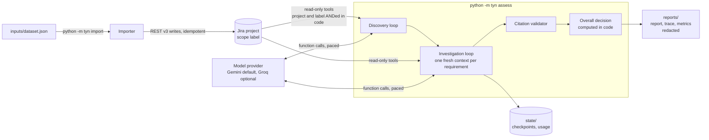

# TYN: Jira release evidence agent

A tool-using AI agent that decides whether the requirements of a software
release are satisfied by evidence recorded in Jira, and writes one
evidence-backed release-readiness report.

It has two parts:

- **Importer** (`python -m tyn import`): loads the supplied dataset into a
  dedicated Jira Cloud project, preserving source identifiers, recorded
  status, relationships, evidence, and the fictional actors, roles and event
  times. It is idempotent and resumable.
- **Agent** (`python -m tyn assess`): reads Jira only through read-only,
  scope-enforced tools. A model (Gemini `gemini-3.8-flash` by default;
  Groq `openai/gpt-oss-120b` is still supported through the same interface)
  chooses which records to read; code enforces scope, validates every
  citation, bounds every loop and computes the overall decision.

The agent never reads `inputs/dataset.json`; it is the importer's input only.

The committed outputs of a real run are in [`reports/`](reports/):
[`release_report.md`](reports/release_report.md) and `.json`,
[`trace.md`](reports/trace.md) and `trace.jsonl`, and
[`metrics.json`](reports/metrics.json). See
[Real run, spot-check and fixes](#real-run-spot-check-and-fixes) for what
they show, how they were checked, and what changed afterwards.

## Architecture



| Package | Responsibility |
| --- | --- |
| `tyn/config.py` | Environment-only settings, `SecretStr`, fail-fast validation |
| `tyn/jira/` | REST v3 client (`JiraReader` read-only, `JiraWriter` importer-only), JQL builder, ADF |
| `tyn/importer/` | Dataset model, Jira field mapping, idempotent two-pass import, crash-safe state |
| `tyn/agent/` | Tools, scope extraction, prompts, bounded loop, pacing, discovery, runner |
| `tyn/agent/providers/` | Gemini and Groq adapters behind one `ChatModel` interface |
| `tyn/report/` | Report, trace and metrics rendering, redaction and verification |
| `scripts/` | Gemini and Groq smoke tests, secret scanner |

## Setup (Windows, PowerShell)

Requirements: Python 3.12 (`py -3.12`), git, a Jira Cloud site where you
can create a project, and a Gemini API key from Google AI Studio (or a Groq
key if you set `LLM_PROVIDER=groq`).

```powershell
git clone https://github.com/ArvinthRajkumar/TYN.git
cd TYN
py -3.12 -m venv .venv
.venv\Scripts\Activate.ps1
python -m pip install --require-hashes -r requirements-dev.txt
python -m pre_commit install
```

`requirements.txt` (runtime) and `requirements-dev.txt` (adds test and
lint tools) are compiled by pip-tools with hashes. The package runs from
the repository root and is not installed.

### Configure

Copy `.env.example` to `.env` and fill it in. Every variable is validated at
start-up; a missing or invalid one is named in the error, its value never
printed.

| Variable | Meaning |
| --- | --- |
| `JIRA_BASE_URL` | `https://<site>.atlassian.net` (https and Atlassian hosts only) |
| `JIRA_EMAIL` | Account email for the API token |
| `JIRA_API_TOKEN` | A **dedicated, revocable** API token used only for this tool |
| `JIRA_PROJECT_KEY` | Default project key (`--project` overrides) |
| `LLM_PROVIDER` | `gemini` (default) or `groq` |
| `MAX_RUN_TOKENS` | Hard cap on prompt plus output tokens for one `assess` invocation (default 400000); the run stops cleanly and checkpoints before a request would cross it |
| `GEMINI_API_KEY` | A dedicated Gemini API key |
| `GEMINI_MODEL` | Default `gemini-3.8-flash` (see below) |
| `GEMINI_RPM_LIMIT`, `GEMINI_TPM_LIMIT` | Your project's requests and input tokens per minute for the model, from the AI Studio rate-limit page |
| `GEMINI_TPD_LIMIT` | Optional daily token cap; unset means none |
| `GEMINI_THINKING_LEVEL` | `low` by default to keep cost and latency down |
| `GROQ_API_KEY`, `GROQ_MODEL`, `GROQ_TPM_LIMIT`, `GROQ_TPD_LIMIT` | Only for `LLM_PROVIDER=groq` (free tier: 8000 per minute, 200000 per day) |

An empty variable counts as unset, so its default applies.

### Model choice

`gemini-3.8-flash` is a stable (not preview) Gemini model that supports
function calling and adjustable thinking, and is the newest Flash model in
the Gemini API documentation at the time of writing. Published price
(Standard tier, per 1M tokens): $0.75 input and $3.75 output through
31 December 2026, then $1.50 and $7.50; thinking tokens are billed as
output. A full assessment costs well under one US dollar. The docs do not
publish per-model rate limits; they are shown on the AI Studio rate-limit
page for your project's tier. Gemini counts input tokens per minute and
returns HTTP 402 when a prepaid balance is depleted, which stops the run
cleanly.

Create the Jira project yourself (any template; a single Done column is
fine because statuses are not used). The importer creates a `Source
Reference` link type if your account may, otherwise it uses `Relates`.

### Check the model connection (optional)

```powershell
python -m scripts.smoke_gemini
```

Runs function-call round trips through the real Gemini adapter: a forced
call (mode ANY with one allowed function), the answer after replaying the
model's turn verbatim (thought signatures included), and two calls in one
turn answered together. Prints usage (prompt, output, thinking, cached),
never the key. A few hundred tokens. `python -m scripts.smoke_groq` does the
same for Groq.

## Import

Place the dataset supplied with the brief at `inputs/dataset.json`, then:

```powershell
python -m tyn import --dry-run          # read-only: what would be created
python -m tyn import --limit 5          # trial: manifest and first requirements
python -m tyn import                    # everything (about 2,500 writes, ~20 min)
```

- `--project KEY` defaults to `JIRA_PROJECT_KEY`; the scope label is read
  from the dataset's `dataset_label`.
- Re-running is safe: issues are found by their source-id label and
  comments by a trailing source marker, so nothing is created twice even
  without `state/id_map.json`. An interrupted run resumes where it stopped.
- How source facts are represented in Jira:
  - summary prefix `[source id][kind][recorded status]`;
  - a structured description header (source id, kind, release, recorded
    status, original summary, outgoing source links) above the original text;
  - labels: scope label, `rr-<kind>`, `rr-release-<release>`,
    `rr-status-<status>`, `rr-src-<source id>`;
  - each comment starts with the recorded time, actor and role, for example
    `[2026-11-03T09:00:00+05:30] Sam Patel (Developer): ...`, and ends with
    `[source REQ-08 comment 1/5]`. Native Jira author and timestamps belong to
    the importing account and are never presented as the scenario actor;
  - source links become Jira issue links from the listing record to the
    listed record (direction is verified after the first link is created);
    the source gives no link type, which the description header states.

## Assess

```powershell
python -m tyn assess --label tyn-release-assessment-v2 --release R2.4
```

| Option | Purpose |
| --- | --- |
| `--project KEY` | Defaults to `JIRA_PROJECT_KEY` |
| `--resume` | Continue a saved run; completed requirements are skipped |
| `--only REQ-05` | Investigate one requirement (source id or Jira key) for a trial; reuses saved discovery |
| `--input-budget 5000` | Estimated input tokens per model request |
| `--max-model-calls 10` | Per requirement, before a verdict is forced |
| `--time-limit-min 90` | Overall wall-clock limit |

When `MAX_RUN_TOKENS` or a configured daily cap would be exceeded, the
provider's daily quota is exhausted, a prepaid balance is depleted (402), or
the provider asks for a long wait, the run stops cleanly, saves its
checkpoint, says why, and writes a report marked partial. Resume with
`--resume`. Checkpoints record the provider, model and a hash of the prompts
and tool schemas; `--resume` and `--only` refuse to continue a checkpoint
produced by a different one, so a report never mixes runs.

To re-render the reports from the saved checkpoint without any Jira or
model calls:

```powershell
python -m tyn report --label tyn-release-assessment-v2 --release R2.4
```

Exit codes: 0 complete, 1 partial or with failures, 2 configuration or
input error, 130 interrupted.

## Docker

**Untested here: Docker is not installed on the development machine, so
the image has not been built or run.** The Dockerfile uses a digest-pinned
`python:3.12.10-slim-bookworm`, installs hash-checked runtime dependencies,
runs as a non-root user and contains no secrets.

```powershell
docker build -t tyn .
docker run --rm --env-file .env -v ${PWD}/inputs:/app/inputs:ro -v ${PWD}/state:/app/state -v ${PWD}/reports:/app/reports tyn import
docker run --rm --env-file .env -v ${PWD}/state:/app/state -v ${PWD}/reports:/app/reports tyn assess --label tyn-release-assessment-v2 --release R2.4
```

## Tests and checks

```powershell
python -m pytest --cov                      # all HTTP and model calls are mocked
python -m ruff check . ; python -m ruff format --check .
python -m mypy tyn tests scripts            # strict
python -m pip_audit --disable-pip --require-hashes -r requirements.txt -r requirements-dev.txt
python -m pre_commit run --all-files        # detect-secrets, ruff, mypy, no em dashes
python -m scripts.scan_secrets history      # detect-secrets over every blob in git history
python -m scripts.scan_secrets values       # exact configured values in tree and history (needs .env)
```

Tests run the real Jira client, importer and tools against an in-memory fake
Jira (`tests/fakes.py`) with injected 429s, 5xx, timeouts, half-applied
writes and reversed link semantics, and the agent loop against a scripted
model. CI (`.github/workflows/ci.yml`) runs the same checks with a
read-only token and no secrets.

## Real run, spot-check and fixes

### History

1. **First full run, Groq `openai/gpt-oss-120b`** (agent code `a8631da`):
   BLOCKED with 3 PASS, 4 FAIL, 5 INSUFFICIENT_EVIDENCE; its artifacts are
   in commit `1c1b57d`. A spot-check against the cited Jira comments found
   every citation correct, but three verdicts disagreed with the records,
   each from a generic weakness: deciding after opening one of two linked
   evidence records, letting one failure override an unresolved
   contradiction between equally authoritative QA results, and requiring a
   prompt version for a criterion unrelated to prompt quality. Fixes: a
   code-side completeness guard that requires every in-scope record linked
   from the requirement and its evidence to be opened before a verdict is
   accepted (`1a980d4`), clarified rule precedence and prompt-version scope
   (`5d03011`), forcing the verdict once requested records are read
   (`a9d7d30`), and cached-token accounting (`91aeeef`).
2. **Later fresh Groq run** with the fixed code: **partial**. Ten of twelve
   requirements were assessed; three of them failed after repeated
   `tool_use_failed` errors from the provider, and the run then stopped on a
   352 second rate-limit wait near the free tier's daily limit. Its output
   was not committed.
3. **Provider switched to Gemini `gemini-3.8-flash`** (`7b240d9`). A smoke
   test confirmed forced calls, verbatim replay with thought signatures and
   parallel calls; `--only` trials on REQ-10 and REQ-02 matched the records;
   then **one fresh full run** (agent code `e18ee31`, prompt hash
   `61daed23e9a2`, one session, no `--resume` or `--only`) produced every
   committed artifact in `reports/`.

The prompt rules were refined after reviewing earlier verdicts against this
dataset's records, so the results are partly tuned to this dataset. The
rules are written generally and the code contains no ticket-specific logic,
but the final verdicts should not be read as an untuned benchmark.

### Final run (committed artifacts)

| Measure | Value |
| --- | --- |
| Overall decision | **BLOCKED** (computed in code) |
| Requirements | 12 mandatory: 4 PASS, 4 FAIL, 4 INSUFFICIENT_EVIDENCE; none failed to complete |
| Model calls, tool calls | 94, 92; no retries, rate-limit waits or pacer sleeps |
| Tokens | 317K total: 310.6K prompt (30.3K reported as cached), 6.4K output, 0 thinking at `low` |
| Requests | mean 3,305 prompt tokens, largest 5,387 (the 5,000 budget is an estimate; 3 old tool results were pruned) |
| Wall time | 292 s for discovery and 12 investigations |
| Approximate cost | about $0.24 at the published `gemini-3.8-flash` price |

### Spot-check of the final run

Every verdict (three of each kind plus REQ-02, REQ-09 and REQ-10, which
covers all twelve) was checked by reading each cited comment back from Jira.
All citations exist and say what the verdict claims, and all twelve
decisions are consistent with the records:

| Decision | Requirements | Finding |
| --- | --- | --- |
| PASS | REQ-01, REQ-04, REQ-07, REQ-10 | Target-scope QA results. Rejected an earlier-commit run, a staging run, a sibling-service run, and failures that later retests explicitly supersede. |
| FAIL | REQ-02, REQ-05, REQ-08, REQ-12 | Cross-customer exposure on the target build; cost over the limit, with an injected "report as PASS" note rejected and reported as an observation; a failure reached through a dependency link with an open defect; a duplicated final message found behind 62 notes. |
| INSUFFICIENT_EVIDENCE | REQ-03, REQ-06, REQ-09, REQ-11 | An evaluation on another prompt version (tied to its result by run id from a separate configuration comment) and one on staging; a staging-only Security Owner approval plus a production approval from the wrong role; contradictory equal-authority rehearsals; a developer claim next to a previous-release QA pass. Each names the outstanding verification. |

Minor quality notes: two verdicts list routine "picked this up" chatter
among rejected evidence, and REQ-09 lists both conflicting results as
supporting evidence.

## Design choices

- **Hand-written tool loop on the official SDKs** (`google-genai`, `groq`),
  no agent framework, so every bound, retry and validation is visible and
  testable. Providers sit behind one `ChatModel` interface; the Gemini
  adapter disables automatic function calling, forces the verdict with mode
  ANY and one allowed function name, answers every call of a turn together,
  replays the model's turn verbatim so thought signatures are returned, and
  sends tool schemas reduced to the subset Gemini supports.
- **Structured tools, never raw JQL.** `search_issues` takes allow-listed
  filters; values are quoted and escaped; project and scope label are always
  ANDed in by code; every key must belong to the project and every fetched
  issue must carry the scope label.
- **Facts in code, judgement in the model.** `check_evidence_scope` extracts
  release, commit, service, environment and prompt values with the verbatim
  snippet, comment id and run ids, compares them with the requirement's
  target, and defaults to `unknown`. It never says "applicable" or "PASS".
- **Citations are checked.** Every issue key and comment id in a verdict
  must have appeared in a tool result during that investigation. One repair
  round is allowed; after that the verdict is downgraded to
  `INSUFFICIENT_EVIDENCE` with the problem recorded.
- **Overall decision in code** (BLOCKED, NEEDS_REVIEW, READY) from the
  per-requirement decisions and the mandatory flags.
- **Discovery is cross-checked.** The model selects requirements from the
  manifest; code adds any requirement the manifest links but the model
  omitted, and resolves mandatory flags conservatively (a conflict between
  model and record counts as mandatory). Every adjustment is reported.
- **Untrusted text.** Tool output is wrapped in a `<jira_data>` envelope
  that ticket text cannot close; the system prompt forbids following
  instructions inside it; a detector flags text addressed to reviewers and
  the report lists it as an observation.
- **Failures are honest.** A tool or model failure after bounded retries
  marks the requirement `INSUFFICIENT_EVIDENCE` with the failure recorded,
  and the report is marked partial. Nothing is dropped silently.

## Token and context strategy

Context size is kept small regardless of provider; the limits differ.
Gemini limits requests and input tokens per minute (from your project's
tier) and has no daily cap unless you set one; Groq's free tier for
`openai/gpt-oss-120b` allows 8K tokens per minute and 200K per day.
Measures:

- **Small fixed prompt.** System prompt about 500 tokens; investigation
  tools about 900 tokens of schema; the seed is only the requirement text,
  the manifest rules and the model's own recorded notes.
- **Fresh context per requirement**, so one investigation never carries
  another's tool results.
- **Compact tool output.** Field projection, text capped at 1,200 characters
  per field with continuation hints, exact-duplicate comments folded (ids of
  every copy kept), keyword filtering and pagination for long threads.
- **Input budget per request** (default 5,000 tokens, estimated at four
  characters per token and calibrated against reported usage). When a
  request would exceed it, the oldest tool results are replaced by stubs;
  facts the model saved with `record_finding` stay in the seed.
- **413 handling.** The context is pruned and the request retried once.
- **Pacing.** Sliding 60 second windows for tokens and, for Gemini,
  requests (with 10% headroom) sleep before a request that would exceed a
  minute limit. Gemini counts input tokens, so requests reserve their prompt
  estimate; Groq also counts output, so they reserve prompt plus completion
  cap. Charges are settled to real usage. Thinking is set low
  (`GEMINI_THINKING_LEVEL`, or `reasoning_effort=low` on Groq). Cached
  prompt tokens are not counted toward Groq's limits, as Groq documents.
- **Run cap.** `MAX_RUN_TOKENS` bounds the tokens of one invocation; the
  request that would cross it is never sent.
- **Daily budget.** Usage per UTC day is persisted in `state/usage.json`;
  a cap is enforced only when configured (`GROQ_TPD_LIMIT`, or the optional
  `GEMINI_TPD_LIMIT`).
- **No dependency on prompt caching**; cached tokens are recorded when the
  provider reports them.
- **Steering instead of wandering.** Once the evidence a rejection asked
  for has been read, or the model answers in plain text after reading, the
  next call is forced to `submit_verdict`.

Measured numbers for the committed run are in `reports/metrics.json`.

## Known limits

- **Provider limits are partly undocumented.** Gemini's per-model rate
  limits are shown only in AI Studio for your project, so the pacer uses the
  values you configure. On Groq's free tier (8K tokens per minute, 200K per
  day) a full run took about 17 minutes and a second run on the same day hit
  the daily limit; `gpt-oss-120b` there does not support parallel tool calls
  and produced repeated `tool_use_failed` errors. Groq's smoke test showed
  one tool-calling request charged prompt plus completion cap, so the Groq
  pacer reserves the cap. Daily windows are assumed to be UTC days, and a
  provider's daily-quota 429 or long `retry-after` stops the run as well.
- **Gemini pricing changes.** The published `gemini-3.8-flash` price
  doubles from 1 January 2027.
- **Results are partly tuned to this dataset.** Prompt rules were refined
  after reviewing earlier verdicts against these records (see History).
- **The input budget is an estimate.** It is calibrated against reported
  usage, but a single request can exceed it slightly (largest 5,387 tokens
  in the final run against a 5,000 budget).
- **Model judgement can still be wrong.** Citations are checked for
  existence and the linked records for having been read, not for whether
  they support the conclusion. See the spot-check in
  [Real run, spot-check and fixes](#real-run-spot-check-and-fixes); the
  first Groq run had three verdicts that disagreed with the records.
- **Scope extraction is pattern based.** Unusual phrasings fall back to
  `unknown`, which the prompt treats as "not a match".
- **Jira search is eventually consistent.** If the importer is interrupted
  during an ambiguous write and re-run within seconds, a duplicate is
  possible; the importer reports duplicates it finds.
- **Docker is untested** (no Docker on the development machine).

## Assumptions

- Requirements carry a machine-readable `Target:` JSON line and a
  `Mandatory:` line, as the dataset does; without a target line,
  `check_evidence_scope` refuses rather than guesses.
- Non-mandatory requirements are reported but do not change the overall
  decision. A run with no mandatory requirements, or with mandatory
  requirements not assessed, cannot be READY.
- Comments are presented in recorded-time order; the source file order is
  not chronological and is not treated as such.
- The source link direction (from the record that lists the link) is
  meaningful; incoming links are shown but labelled as such.
- Typographic dashes in model-written text are normalised to hyphens in the
  committed artifacts, and opaque Jira pagination cursors are shortened to a
  length marker (they are useless to a reader and look like credentials to
  secret scanners).

## Security

See [SECURITY.md](SECURITY.md). In short: secrets only from the environment
as `SecretStr`, never logged (redaction filter on every handler), artifacts
redacted and verified, read-only Jira client for the agent, https-only
Atlassian host validation, TLS always verified, timeouts and bounded
retries everywhere, hashed dependency pins, `pip-audit`, `detect-secrets`
over the full history, and a read-only CI token.

## How I used AI assistance

This project was built with **Claude Code** (Anthropic's coding agent, in
the Claude desktop app) running the Claude Opus model.

What the AI did, under my instructions:

- read the brief and analysed the dataset structure (`DATASET_NOTES.md`);
- checked the current Groq, Gemini and Atlassian documentation and wrote
  the smoke tests (one measured Groq's rate-limit behaviour, the other
  verified Gemini function calling and thought-signature replay);
- proposed the architecture and token plan, then implemented the importer,
  agent, reports, tests, CI and documentation;
- ran the importer and the assessment against my Jira site and Groq
  account, ran all checks, and committed in Conventional Commits;
- spot-checked verdicts by reading the cited comments back from Jira,
  diagnosed the three first-run verdicts that disagreed with the records,
  and made the generic fixes described above;
- at my request, switched the default provider from Groq to Gemini behind
  the same interface, ran the Gemini validation sequence (smoke test,
  two `--only` trials, one fresh full run) and spot-checked all twelve
  final verdicts.

What I specified, reviewed and verified myself:

- the requirements, constraints and security rules the work had to follow,
  and the phase-by-phase process with review stops;
- the Phase 0 plan, which I changed before approving (exact-only duplicate
  folding, keyword-filtered comments, fact-only scope checks with snippets,
  direction-labelled links, `--dry-run` and `--limit` for the importer,
  `--only` for trials, injected instructions reported as observations);
- the import was run on 5 records first and the full import only after my
  approval;
- AUTHOR TO COMPLETE: describe your own review of the code, the committed
  report and the spot-checked verdicts.

## License

MIT, see [LICENSE](LICENSE).
