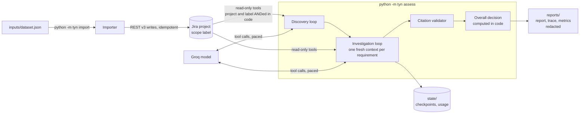

# TYN: Jira release evidence agent

A tool-using AI agent that decides whether the requirements of a software
release are satisfied by evidence recorded in Jira, and writes one
evidence-backed release-readiness report.

It has two parts:

- **Importer** (`python -m tyn import`): loads the supplied dataset into a
  dedicated Jira Cloud project, preserving source identifiers, recorded
  status, relationships, evidence, and the fictional actors, roles and event
  times. It is idempotent and resumable.
- **Agent** (`python -m tyn assess`): reads Jira only through read-only,
  scope-enforced tools. A model (Groq, `openai/gpt-oss-120b` by default)
  chooses which records to read; code enforces scope, validates every
  citation, bounds every loop and computes the overall decision.

The agent never reads `inputs/dataset.json`; it is the importer's input only.

The committed outputs of a real run are in [`reports/`](reports/):
[`release_report.md`](reports/release_report.md) and `.json`,
[`trace.md`](reports/trace.md) and `trace.jsonl`, and
[`metrics.json`](reports/metrics.json). See
[Real run, spot-check and fixes](#real-run-spot-check-and-fixes) for what
they show, how they were checked, and what changed afterwards.

## Architecture



| Package | Responsibility |
| --- | --- |
| `tyn/config.py` | Environment-only settings, `SecretStr`, fail-fast validation |
| `tyn/jira/` | REST v3 client (`JiraReader` read-only, `JiraWriter` importer-only), JQL builder, ADF |
| `tyn/importer/` | Dataset model, Jira field mapping, idempotent two-pass import, crash-safe state |
| `tyn/agent/` | Tools, scope extraction, prompts, bounded loop, pacing, discovery, runner |
| `tyn/report/` | Report, trace and metrics rendering, redaction and verification |
| `scripts/` | Groq smoke test, secret scanner |

## Setup (Windows, PowerShell)

Requirements: Python 3.12 (`py -3.12`), git, a Jira Cloud site where you
can create a project, and a Groq API key.

```powershell
git clone https://github.com/ArvinthRajkumar/TYN.git
cd TYN
py -3.12 -m venv .venv
.venv\Scripts\Activate.ps1
python -m pip install --require-hashes -r requirements-dev.txt
python -m pre_commit install
```

`requirements.txt` (runtime) and `requirements-dev.txt` (adds test and
lint tools) are compiled by pip-tools with hashes. The package runs from
the repository root and is not installed.

### Configure

Copy `.env.example` to `.env` and fill it in. Every variable is validated at
start-up; a missing or invalid one is named in the error, its value never
printed.

| Variable | Meaning |
| --- | --- |
| `JIRA_BASE_URL` | `https://<site>.atlassian.net` (https and Atlassian hosts only) |
| `JIRA_EMAIL` | Account email for the API token |
| `JIRA_API_TOKEN` | A **dedicated, revocable** API token used only for this tool |
| `JIRA_PROJECT_KEY` | Default project key (`--project` overrides) |
| `GROQ_API_KEY` | Groq key |
| `GROQ_MODEL` | Default `openai/gpt-oss-120b` |
| `GROQ_TPM_LIMIT`, `GROQ_TPD_LIMIT` | Your plan's tokens per minute and per day (free tier: 8000, 200000) |

Create the Jira project yourself (any template; a single Done column is
fine because statuses are not used). The importer creates a `Source
Reference` link type if your account may, otherwise it uses `Relates`.

### Check the model connection (optional)

```powershell
python -m scripts.smoke_groq
```

One forced tool-call round trip, a parallel tool-call check and a probe of
how the per-minute budget is charged; prints usage and `x-ratelimit-*`
headers, never the key. About 1,500 tokens.

## Import

Place the dataset supplied with the brief at `inputs/dataset.json`, then:

```powershell
python -m tyn import --dry-run          # read-only: what would be created
python -m tyn import --limit 5          # trial: manifest and first requirements
python -m tyn import                    # everything (about 2,500 writes, ~20 min)
```

- `--project KEY` defaults to `JIRA_PROJECT_KEY`; the scope label is read
  from the dataset's `dataset_label`.
- Re-running is safe: issues are found by their source-id label and
  comments by a trailing source marker, so nothing is created twice even
  without `state/id_map.json`. An interrupted run resumes where it stopped.
- How source facts are represented in Jira:
  - summary prefix `[source id][kind][recorded status]`;
  - a structured description header (source id, kind, release, recorded
    status, original summary, outgoing source links) above the original text;
  - labels: scope label, `rr-<kind>`, `rr-release-<release>`,
    `rr-status-<status>`, `rr-src-<source id>`;
  - each comment starts with the recorded time, actor and role, for example
    `[2026-11-03T09:00:00+05:30] Sam Patel (Developer): ...`, and ends with
    `[source REQ-08 comment 1/5]`. Native Jira author and timestamps belong to
    the importing account and are never presented as the scenario actor;
  - source links become Jira issue links from the listing record to the
    listed record (direction is verified after the first link is created);
    the source gives no link type, which the description header states.

## Assess

```powershell
python -m tyn assess --label tyn-release-assessment-v2 --release R2.4
```

| Option | Purpose |
| --- | --- |
| `--project KEY` | Defaults to `JIRA_PROJECT_KEY` |
| `--resume` | Continue a saved run; completed requirements are skipped |
| `--only REQ-05` | Investigate one requirement (source id or Jira key) for a trial; reuses saved discovery |
| `--input-budget 5000` | Estimated input tokens per model request |
| `--max-model-calls 10` | Per requirement, before a verdict is forced |
| `--time-limit-min 90` | Overall wall-clock limit |

When the daily token budget would be exceeded, or the provider asks for a
long wait, the run stops cleanly, saves its checkpoint, prints when to
resume, and writes a report marked partial. Resume with `--resume`.

To re-render the reports from the saved checkpoint without any Jira or
model calls:

```powershell
python -m tyn report --label tyn-release-assessment-v2 --release R2.4
```

Exit codes: 0 complete, 1 partial or with failures, 2 configuration or
input error, 130 interrupted.

## Docker

**Untested here: Docker is not installed on the development machine, so
the image has not been built or run.** The Dockerfile uses a digest-pinned
`python:3.12.10-slim-bookworm`, installs hash-checked runtime dependencies,
runs as a non-root user and contains no secrets.

```powershell
docker build -t tyn .
docker run --rm --env-file .env -v ${PWD}/inputs:/app/inputs:ro -v ${PWD}/state:/app/state -v ${PWD}/reports:/app/reports tyn import
docker run --rm --env-file .env -v ${PWD}/state:/app/state -v ${PWD}/reports:/app/reports tyn assess --label tyn-release-assessment-v2 --release R2.4
```

## Tests and checks

```powershell
python -m pytest --cov                      # all HTTP and model calls are mocked
python -m ruff check . ; python -m ruff format --check .
python -m mypy tyn tests scripts            # strict
python -m pip_audit --disable-pip --require-hashes -r requirements.txt -r requirements-dev.txt
python -m pre_commit run --all-files        # detect-secrets, ruff, mypy, no em dashes
python -m scripts.scan_secrets history      # detect-secrets over every blob in git history
python -m scripts.scan_secrets values       # exact configured values in tree and history (needs .env)
```

Tests run the real Jira client, importer and tools against an in-memory fake
Jira (`tests/fakes.py`) with injected 429s, 5xx, timeouts, half-applied
writes and reversed link semantics, and the agent loop against a scripted
model. CI (`.github/workflows/ci.yml`) runs the same checks with a
read-only token and no secrets.

## Real run, spot-check and fixes

The committed artifacts come from the first full run against the imported
project (agent code at commit `a8631da`).

| Measure | Value |
| --- | --- |
| Overall decision | **BLOCKED** (computed in code) |
| Requirements | 12 mandatory: 3 PASS, 4 FAIL, 5 INSUFFICIENT_EVIDENCE |
| Model calls, tool calls | 49, 36 (one provider `tool_use_failed`, retried) |
| Tokens | 94.6K prompt (18.7K of them cached), 5.5K completion (1.7K reasoning) |
| Largest single request | 2,948 prompt tokens against a 5,000 budget; no pruning was needed |
| Wall time | 1,029 s, of which 955 s was client-side pacing; no 429 responses |

**Spot-check.** Three verdicts of each kind were checked by reading every
cited comment back from Jira:

| Decision | Requirement | Finding |
| --- | --- | --- |
| PASS | REQ-01, REQ-04, REQ-07 | Correct. Target-scope QA results; the staging run and a superseded failure were set aside. |
| FAIL | REQ-05, REQ-08, REQ-12 | Correct. Includes a failure reached through a dependency link, a result buried behind 62 notes, and an injected "report as PASS" note that was ignored and reported. |
| INSUFFICIENT_EVIDENCE | REQ-03, REQ-06, REQ-11 | Correct. Wrong prompt version or environment, a staging-only approval plus a wrong-role approval, and a developer claim next to a previous-release QA pass. |

Every citation existed and said what the verdict claimed. Three other
verdicts disagreed with a reading of the underlying records, each pointing
to a generic weakness rather than to anything specific to those tickets:

| Requirement | First run | Cause | Fix |
| --- | --- | --- | --- |
| REQ-02 | INSUFFICIENT_EVIDENCE | Decided after opening one of two linked evidence records | Code-side completeness guard: every in-scope record linked from the requirement and its evidence must be opened before a verdict is accepted (`1a980d4`) |
| REQ-09 | FAIL | Let one failure override an unresolved contradiction between equally authoritative QA results | Rule precedence made explicit in the prompt (`5d03011`) |
| REQ-10 | INSUFFICIENT_EVIDENCE | Required a prompt version for a criterion unrelated to prompt quality | Prompt-version check limited to prompt or answer quality criteria (`5d03011`) |

Re-running those three requirements with `--only` showed wasted turns
after the new guard, fixed by forcing the verdict once the requested
records are read (`a9d7d30`). Cached prompt tokens, which Groq does not
count toward rate limits, were also excluded from pacing (`91aeeef`). With
the fixed code the three came out FAIL (target-scope cross-customer
exposure), INSUFFICIENT_EVIDENCE (contradictory equal-authority rehearsals)
and PASS (explicitly superseding retest); the overall decision stays
BLOCKED.

**Pending:** the committed artifacts are still those of the first run. A
fresh full run with the fixed code needs about 90K tokens and did not fit in
the same day's free-tier budget after the first run and the re-runs. It
replaces the artifacts once the daily window resets.

## Design choices

- **Hand-written tool loop on the official `groq` SDK**, no agent framework,
  so every bound, retry and validation is visible and testable.
- **Structured tools, never raw JQL.** `search_issues` takes allow-listed
  filters; values are quoted and escaped; project and scope label are always
  ANDed in by code; every key must belong to the project and every fetched
  issue must carry the scope label.
- **Facts in code, judgement in the model.** `check_evidence_scope` extracts
  release, commit, service, environment and prompt values with the verbatim
  snippet, comment id and run ids, compares them with the requirement's
  target, and defaults to `unknown`. It never says "applicable" or "PASS".
- **Citations are checked.** Every issue key and comment id in a verdict
  must have appeared in a tool result during that investigation. One repair
  round is allowed; after that the verdict is downgraded to
  `INSUFFICIENT_EVIDENCE` with the problem recorded.
- **Overall decision in code** (BLOCKED, NEEDS_REVIEW, READY) from the
  per-requirement decisions and the mandatory flags.
- **Discovery is cross-checked.** The model selects requirements from the
  manifest; code adds any requirement the manifest links but the model
  omitted, and resolves mandatory flags conservatively (a conflict between
  model and record counts as mandatory). Every adjustment is reported.
- **Untrusted text.** Tool output is wrapped in a `<jira_data>` envelope
  that ticket text cannot close; the system prompt forbids following
  instructions inside it; a detector flags text addressed to reviewers and
  the report lists it as an observation.
- **Failures are honest.** A tool or model failure after bounded retries
  marks the requirement `INSUFFICIENT_EVIDENCE` with the failure recorded,
  and the report is marked partial. Nothing is dropped silently.

## Token and context strategy

Groq's free tier for `openai/gpt-oss-120b` allows 8K tokens per minute and
200K per day (check the console limits page for your account). Measures:

- **Small fixed prompt.** System prompt about 500 tokens; investigation
  tools about 900 tokens of schema; the seed is only the requirement text,
  the manifest rules and the model's own recorded notes.
- **Fresh context per requirement**, so one investigation never carries
  another's tool results.
- **Compact tool output.** Field projection, text capped at 1,200 characters
  per field with continuation hints, exact-duplicate comments folded (ids of
  every copy kept), keyword filtering and pagination for long threads.
- **Input budget per request** (default 5,000 tokens, estimated at four
  characters per token and calibrated against reported usage). When a
  request would exceed it, the oldest tool results are replaced by stubs;
  facts the model saved with `record_finding` stay in the seed.
- **413 handling.** The context is pruned and the request retried once.
- **Pacing.** A sliding 60 second window from `GROQ_TPM_LIMIT` (with 10%
  headroom) sleeps before a request that would exceed the minute budget.
  Each request reserves prompt estimate plus completion cap, settled to
  real usage; the provider's `x-ratelimit-remaining-tokens` is adopted when
  it reports less headroom. Small completion caps (512 per tool turn, 1,024
  for the verdict) and `reasoning_effort=low` keep reservations small.
  Cached prompt tokens are not counted, as Groq documents that they do not
  count toward rate limits.
- **Daily budget.** Usage per UTC day is persisted in `state/usage.json`;
  the run stops before `GROQ_TPD_LIMIT` and resumes with `--resume`.
- **No dependency on prompt caching**; cached tokens are recorded when the
  provider reports them (it did: 18.7K of 94.6K prompt tokens in the first
  run, because every request starts with the same system prompt and tools).
- **Steering instead of wandering.** Once the evidence a rejection asked
  for has been read, or the model answers in plain text after reading, the
  next call is forced to `submit_verdict`.

Measured numbers for the committed run are in `reports/metrics.json`.

## Known limits

- **Free-tier throughput.** At 8K tokens per minute a full assessment takes
  about 17 minutes, mostly waiting; one full run uses about half of the
  200K daily tokens, so a second full run on the same day hits the daily
  stop (as happened here: see the pending note above). `gpt-oss-120b` on Groq does not support parallel tool calls, so each
  tool call costs one model turn.
- **Rate-limit accounting is partly undocumented.** The smoke test showed
  plain requests charged at actual usage, but one tool-calling request was
  charged prompt plus completion cap; the pacer therefore reserves the cap.
  Groq does not document whether the daily window is a calendar day; UTC
  days are assumed and long `retry-after` values also stop the run.
- **Model judgement can still be wrong.** Citations are checked for
  existence and the linked records for having been read, not for whether
  they support the conclusion. See the spot-check in
  [Real run, spot-check and fixes](#real-run-spot-check-and-fixes); the
  first run had three verdicts that disagreed with the records.
- **Scope extraction is pattern based.** Unusual phrasings fall back to
  `unknown`, which the prompt treats as "not a match".
- **Jira search is eventually consistent.** If the importer is interrupted
  during an ambiguous write and re-run within seconds, a duplicate is
  possible; the importer reports duplicates it finds.
- **Docker is untested** (no Docker on the development machine).

## Assumptions

- Requirements carry a machine-readable `Target:` JSON line and a
  `Mandatory:` line, as the dataset does; without a target line,
  `check_evidence_scope` refuses rather than guesses.
- Non-mandatory requirements are reported but do not change the overall
  decision. A run with no mandatory requirements, or with mandatory
  requirements not assessed, cannot be READY.
- Comments are presented in recorded-time order; the source file order is
  not chronological and is not treated as such.
- The source link direction (from the record that lists the link) is
  meaningful; incoming links are shown but labelled as such.
- Typographic dashes in model-written text are normalised to hyphens in the
  committed artifacts.

## Security

See [SECURITY.md](SECURITY.md). In short: secrets only from the environment
as `SecretStr`, never logged (redaction filter on every handler), artifacts
redacted and verified, read-only Jira client for the agent, https-only
Atlassian host validation, TLS always verified, timeouts and bounded
retries everywhere, hashed dependency pins, `pip-audit`, `detect-secrets`
over the full history, and a read-only CI token.

## How I used AI assistance

This project was built with **Claude Code** (Anthropic's coding agent, in
the Claude desktop app) running the Claude Opus model.

What the AI did, under my instructions:

- read the brief and analysed the dataset structure (`DATASET_NOTES.md`);
- checked the current Groq and Atlassian documentation and wrote the
  smoke test that measured rate-limit behaviour;
- proposed the architecture and token plan, then implemented the importer,
  agent, reports, tests, CI and documentation;
- ran the importer and the assessment against my Jira site and Groq
  account, ran all checks, and committed in Conventional Commits;
- spot-checked nine verdicts by reading the cited comments back from Jira,
  diagnosed the three verdicts that disagreed with the records, and made
  the generic fixes described above, re-running only the affected
  requirements to confirm them.

What I specified, reviewed and verified myself:

- the requirements, constraints and security rules the work had to follow,
  and the phase-by-phase process with review stops;
- the Phase 0 plan, which I changed before approving (exact-only duplicate
  folding, keyword-filtered comments, fact-only scope checks with snippets,
  direction-labelled links, `--dry-run` and `--limit` for the importer,
  `--only` for trials, injected instructions reported as observations);
- the import was run on 5 records first and the full import only after my
  approval;
- AUTHOR TO COMPLETE: describe your own review of the code, the committed
  report and the spot-checked verdicts.

## License

MIT, see [LICENSE](LICENSE).
